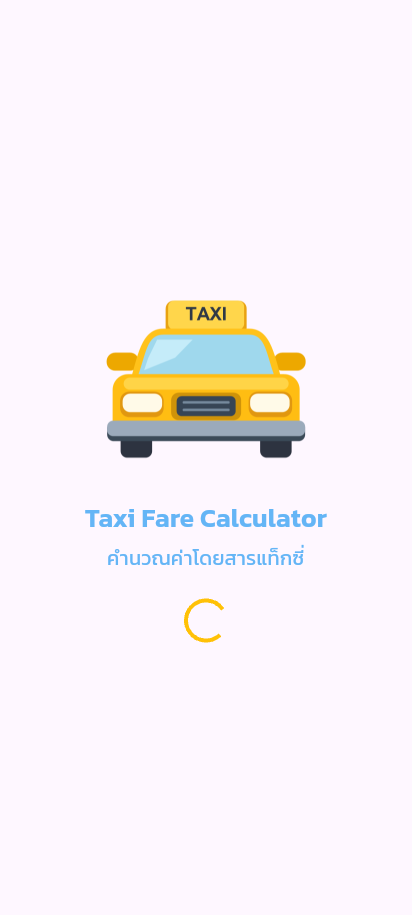

# Taxi Fare Calculator

แอปพลิเคชันคำนวณค่าโดยสารแท็กซี่จากระยะทางและเวลาที่รถติด พัฒนาด้วย Flutter และ Dart

## ฟังก์ชันการทำงาน

- แสดงหน้าเปิดแอป 3 วินาทีก่อนเข้าสู่หน้าคำนวณ
- คำนวณค่าโดยสารจากระยะทางแบบขั้นบันไดและเวลาที่รถติด แสดงผลเป็นบาทสองตำแหน่ง
- แสดง SnackBar เมื่อข้อมูลไม่ครบหรือไม่ถูกต้อง และล้างค่าที่กรอกพร้อมคืนผลเป็น 0.00 บาทเมื่อกด **ยกเลิก**

## ภาพหน้าจอแอปพลิเคชัน

ภาพจากแอปใน Chrome แบบเบื้องหลังที่ขนาด 412 × 915 logical pixels ตามขนาดอ้างอิงโดยประมาณของ Samsung Galaxy S20 Ultra ใน Figma

| Splash | Taxi Fare |
| :---: | :---: |
|  |  |

| แจ้งเตือนเมื่อกรอกไม่ครบ | ผลคำนวณ |
| :---: | :---: |
|  |  |

## เทคโนโลยีที่ใช้

| เทคโนโลยี / Package | หน้าที่ |
| --- | --- |
| Flutter 3.50 และ Dart 3.14 | สร้างหน้าจอและเขียนตรรกะคำนวณ |
| `material_ui` 1.11.1 | ส่วนประกอบ Material สำหรับหน้าจอ |
| `flutter_test` และ `flutter_lints` 6.0.0 | ทดสอบและตรวจรูปแบบโค้ด |
| Kanit | ฟอนต์ที่ใช้แสดงข้อความในแอป |

## โครงสร้างโปรเจกต์

| ไฟล์ / โฟลเดอร์ | Class / ข้อมูล | หน้าที่ |
| --- | --- | --- |
| `lib/main.dart` | จุดเริ่มต้นแอป | เรียกหน้าเปิดแอป |
| `lib/taxi_fare.dart` | ตรรกะค่าโดยสาร | คำนวณค่าระยะทางและเวลารถติด |
| `lib/views/splash_screen_ui.dart` | `SplashScreenUi` | แสดงหน้าเปิดแอป 3 วินาที แล้วเปิดหน้าคำนวณ |
| `lib/views/taxi_fare_ui.dart` | `TaxiFareUi` | รับค่า ตรวจข้อมูล แสดงผล และล้างข้อมูล |
| `test/` | ชุดทดสอบ | ตรวจสูตรค่าโดยสารและการทำงานของหน้าจอ |
| `assets/` และ `docs/screenshots/` | ภาพ ฟอนต์ และภาพหน้าจอ | เก็บทรัพยากรของแอปและภาพประกอบ README |
| `android/`, `ios/` และ `web/` | โครงสร้างแพลตฟอร์ม | เก็บไฟล์ตั้งค่าของแต่ละแพลตฟอร์ม |

## การติดตั้งและใช้งาน

เปิด Terminal ที่โฟลเดอร์โปรเจกต์ด้วย Flutter 3.50 และ Dart 3.14 แล้วรัน

```sh
flutter pub get
flutter run -d chrome
```

กรอกระยะทางมากกว่า 0 กิโลเมตร และเวลารถติดตั้งแต่ 0 นาที ใช้จุดสำหรับทศนิยม แล้วกด **คำนวณค่าโดยสาร** เมื่อข้อมูลไม่ถูกต้อง แอปแสดง SnackBar ปุ่ม **ยกเลิก** ล้างทั้งสองช่องและคืนผลเป็น 0.00 บาท

### วิธีคำนวณ

เริ่มที่ 35 บาทสำหรับระยะทางมากกว่า 0 ถึง 1 กม. คิดระยะทางส่วนที่เกินตามอัตราของแต่ละช่วง แล้วบวกเวลารถติดนาทีละ 3.00 บาท แสดงยอดรวมเป็นบาทสองตำแหน่ง

สำหรับระยะทางมากกว่า 0 แต่น้อยกว่า 1 กม. ผู้จัดทำเลือกคิดค่าโดยสารส่วนระยะทางขั้นต่ำ 35.00 บาท เนื่องจากโจทย์ไม่ได้ระบุวิธีคิดกรณีนี้ไว้อย่างชัดเจน

| ระยะทาง (กม.) | อัตรา |
| --- | ---: |
| มากกว่า 0 ถึง 1 | 35.00 บาท |
| มากกว่า 1 ถึง 10 | 6.50 บาท/กม. |
| มากกว่า 10 ถึง 20 | 7.00 บาท/กม. |
| มากกว่า 20 ถึง 40 | 8.00 บาท/กม. |
| มากกว่า 40 ถึง 60 | 8.50 บาท/กม. |
| มากกว่า 60 ถึง 80 | 9.00 บาท/กม. |
| มากกว่า 80 | 10.50 บาท/กม. |

ตัวอย่าง 25 กม. รถติด 7 นาที คิดเป็น `35 + 9 × 6.50 + 10 × 7.00 + 5 × 8.00 + 7 × 3.00 = 224.50` บาท ภาพตัวอย่างใน Figma แสดง 169.00 บาทสำหรับข้อมูลเดียวกัน แอปใช้อัตราที่ระบุบน [บอร์ด Figma ของ Assignment 05](https://www.figma.com/design/QOtOM4iI0aLiIYD0JkBug2/Project--flutter_taxi_fare_app?node-id=2002-5)

## การทดสอบและข้อจำกัด

โปรเจกต์ผ่าน Technical Acceptance แล้วตามรายงานเดิมของ Codex โดย Flutter Tests ผ่าน 44/44, Flutter Analyze ผ่าน และ Build สำหรับ Web และ Android debug APK ผ่าน คำสั่งที่ใช้มีดังนี้

```sh
flutter analyze
flutter test
flutter build web --no-web-resources-cdn
flutter build apk --debug
```

Claude Independent Review ผ่านด้านเทคนิคโดยอ้างอิงผลทดสอบเดิม และไม่ได้รันชุดทดสอบซ้ำ ภาพหน้าจอมาจาก Chrome ส่วน iOS มีโครงสร้างโปรเจกต์และยังไม่ได้ทดสอบ

ตารางอัตราค่าโดยสารอ้างอิงโจทย์ใน Figma สำหรับโปรเจกต์นี้

## เครดิตและสิทธิ์การใช้งาน

### ทรัพยากรจากอาจารย์

ใช้บอร์ด Figma ของอาจารย์อ้างอิงหน้าจอและตารางค่าโดยสาร เมื่อวันที่ 26 พฤศจิกายน 2569 อาจารย์อนุญาตให้นำทรัพยากรที่ให้มาเผยแพร่บน Public GitHub เพื่อส่งงานรายวิชา ลิขสิทธิ์ยังเป็นของเจ้าของเดิม และเงื่อนไขของเจ้าของสิทธิ์ภายนอกยังมีผล [บอร์ด Assignment 05](https://www.figma.com/design/QOtOM4iI0aLiIYD0JkBug2/Project--flutter_taxi_fare_app?node-id=2002-5)

### Fonts, Packages และ Open-source Licenses

- **Kanit** โดย The Kanit Project Authors ใช้สัญญาอนุญาต SIL Open Font License 1.1 และเก็บไฟล์สัญญาอนุญาตไว้ในโปรเจกต์ [OFL.txt](assets/fonts/OFL.txt) · [Google Fonts](https://github.com/google/fonts/tree/main/ofl/kanit)
- **Flutter SDK และ flutter_test** โดย The Flutter Authors ใช้ BSD 3-Clause [Flutter LICENSE](https://github.com/flutter/flutter/blob/master/LICENSE)
- **material_ui 1.11.1** โดย The Flutter Authors ใช้ BSD 3-Clause [License ของเวอร์ชันที่ใช้](https://pub.dev/packages/material_ui/versions/1.11.1/license)
- **flutter_lints 6.0.0** โดย The Flutter Authors ใช้ BSD 3-Clause [License ของเวอร์ชันที่ใช้](https://pub.dev/packages/flutter_lints/versions/6.0.0/license)

### Third-party Assets และ Trademarks

ภาพ `assets/images/taxi.png` วาดขึ้นสำหรับโปรเจกต์นี้ด้วยสคริปต์ PowerShell และ .NET `System.Drawing` โดยประกอบจากรูปทรง เส้นโค้ง และข้อความ TAXI ที่เรนเดอร์ด้วย Arial จากระบบ สคริปต์เดียวกันใช้ภาพนี้สร้าง launcher icons สำหรับ Android, iOS และ Web รวมถึง favicon การตรวจสอบที่มาครั้งเดิมยืนยันว่ารันสคริปต์ซ้ำแล้วได้ไฟล์ภาพและไอคอนตรงกันทั้ง 26 ไฟล์แบบ byte-for-byte

Arial เป็นฟอนต์จากระบบที่ใช้เรนเดอร์ข้อความในภาพ ไฟล์ฟอนต์ Arial ไม่ได้รวมในโปรเจกต์ เงื่อนไขของเจ้าของสิทธิ์ยังมีผลตามเดิม
